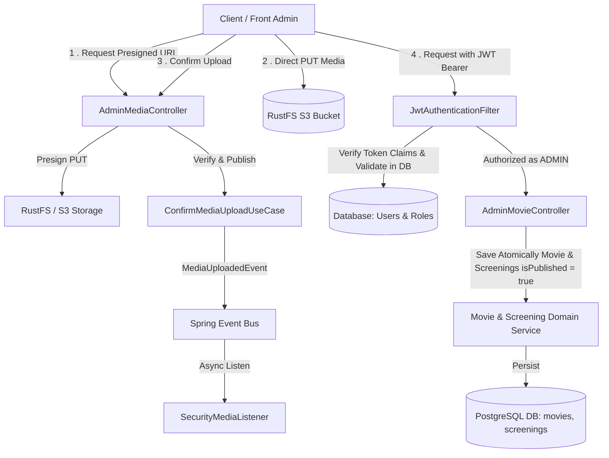

# Requirements

### Overview & Goals

Mettre à disposition une API REST d'administration permettant la création atomique de fiches de films et de leurs
séances associées, la mise à jour des informations, la publication/dépublication de films (`isPublished`), la gestion de
médias (posters images et trailers vidéo ou YouTube) via upload direct S3 RustFS et notification asynchrone Spring
Events, ainsi qu'un système de rôles dynamiques stockés en base de données (`CLIENT`, `ADMIN`, extensibles) avec double
vérification de sécurité (JWT + BDD) et élévation de privilèges.

### Scope

- **In Scope :**
    - Gestion des rôles dynamiques persistés en base de données (table `roles` initialisée avec `CLIENT` et `ADMIN`)
      pour permettre l'ajout de futurs rôles sans redéploiement applicatif.
    - Migration de base de données Flyway créant les tables de rôles, associant le rôle `CLIENT` par défaut aux
      utilisateurs et insérant le compte administrateur initial (`root@root.root` / `root`).
    - Double vérification de sécurité pour les routes ADMIN : validation de la signature/expiration JWT et vérification
      en base de données de l'existence de l'utilisateur (`id`) et de la validité de son rôle `ADMIN`.
    - Endpoint `PATCH /api/v1/users/{id}/role` sécurisé pour élever un utilisateur au rôle `ADMIN` ou lui assigner un
      autre rôle existant en base.
    - Workflow d'upload direct RustFS (S3) via URL pré-signée (`PUT`), confirmation et publication d'événements
      `MediaUploadedEvent` via Spring Events (`@Async`).
    - Support des trailers au format URL externe (ex: YouTube) ou fichier vidéo hébergé (MP4, WebM, etc.).
    - Endpoint `POST /api/v1/admin/movies` créant de façon atomique un film et ses séances.
    - Endpoint `PATCH /api/v1/admin/movies/{id}` pour modifier les informations d'un film.
    - Gestion du cycle de vie des films via le statut `isPublished` (`true`/`false`) : aucun `DELETE` physique pour
      préserver l'historique et l'intégrité des réservations passées et futures.
    - Endpoints d'administration `PATCH /api/v1/admin/movies/{id}/publish` et
      `PATCH /api/v1/admin/movies/{id}/unpublish` (ou modification via `isPublished`).
    - Filtrage côté catalogue public pour n'exposer que les films et séances publiés (`isPublished = true`).
- **Out of Scope :**
    - Moteur de recommandation ou notation des films.
    - Suppression physique (`DELETE`) destructrice des films en base de données.
    - Passerelle de streaming vidéo adaptatif (HLS/DASH).

### User Stories

- *En tant qu'administrateur*, je veux créer une fiche de film en renseignant ses informations, son poster, son trailer
  et ses séances de projection en un seul appel pour garantir la cohérence des données.
- *En tant qu'administrateur*, je veux pouvoir dépublier (`isPublished = false`) ou republier un film sans supprimer
  l'historique de réservations.
- *En tant qu'administrateur*, je veux pouvoir promouvoir un compte client au rôle administrateur (ou attribuer un
  nouveau rôle) via une API dédiée.
- *En tant qu'administrateur*, mes accès critiques sont vérifiés en direct en base de données pour garantir que mon
  compte est toujours valide et actif.
- *En tant que client*, je ne dois pas pouvoir accéder aux endpoints d'administration et je ne dois voir au catalogue
  que les films actuellement publiés.

### Functional Requirements

- **Rôles dynamiques et Sécurité :**
    - Les rôles sont stockés dans la table `roles` en base de données (avec au départ `CLIENT` et `ADMIN`), permettant
      d'insérer de nouveaux rôles en base sans modification du code source.
    - Tout nouvel utilisateur inscrit a le rôle `CLIENT` par défaut.
    - Le compte administrateur initial (`root@root.root` / mot de passe `root`) est inséré via la migration Flyway.
    - Seuls les utilisateurs avec le rôle `ADMIN` peuvent accéder aux routes `/api/v1/admin/**` et
      `PATCH /api/v1/users/{id}/role`.
    - Lors d'une requête sur une route d'administration, le filtre de sécurité valide le token JWT ET effectue une
      vérification en base de données pour s'assurer que l'ID de l'utilisateur correspond aux informations du token et
      possède le rôle `ADMIN` actif.
- **Gestion des Médias :**
    - Obtenir une URL pré-signée S3 (`PUT`) pour le poster (formats images autorisés) et pour la vidéo trailer (formats
      vidéo autorisés).
    - Confirmer le téléversement après succès du `PUT` côté client pour valider l'existence sur RustFS et déclencher le
      traitement asynchrone via `MediaUploadedEvent`.
- **Fiches Films et Séances (Cycle de vie & Publication) :**
    - `POST /api/v1/admin/movies` : validation des données obligatoires (titre, description, durée > 0, poster,
      `isPublished` valant `true` par défaut), enregistrement du film, puis insertion atomique de la liste des séances
      rattachées.
    - `PATCH /api/v1/admin/movies/{id}` : mise à jour partielle des attributs du film (incluant `isPublished`).
    - `PATCH /api/v1/admin/movies/{id}/publish` et `PATCH /api/v1/admin/movies/{id}/unpublish` : bascule du statut de
      visibilité.
    - Le catalogue public (`GET /api/v1/movies`, `GET /api/v1/screenings`) ne renvoie que les éléments où
      `isPublished = true`.
    - L'administration (`GET /api/v1/admin/movies`) permet de consulter tous les films (publiés et dépubliés).
    - Aucune suppression physique (`DELETE`) n'est autorisée sur les films et séances.

# Technical Design

### Current Implementation

- Le modèle de données actuel (`User`, `UserEntity`) ne comporte pas de gestion de rôles.
- `SecurityConfig` autorise toutes les requêtes (`permitAll()`) et `JwtTokenProvider` n'inclut pas de claims de rôle.
- `MovieEntity` et `Movie` ne possèdent pas de champ `isPublished`.
- `MovieRepositoryOut` et `ScreeningRepositoryOut` ne contiennent que des méthodes de lecture sans filtrage de
  publication.
- `RustFsStorageAdapter` n'implémente que `generateUrlAccesMedia` via `S3Presigner`.

### Key Decisions

- **Modèle de rôles dynamiques en base de données :** Création d'une table
  `roles (id BIGSERIAL PRIMARY KEY, name VARCHAR(50) UNIQUE NOT NULL, description TEXT)` et d'une table d'association
  `user_roles (user_id BIGINT, role_id BIGINT)` ou d'une clé étrangère `role_id` sur `users`. Dans le domaine Java, le
  modèle `Role` est une classe/record `Role(Long id, String name)` manipulable dynamiquement, ce qui permet d'ajouter de
  futurs rôles en BDD sans devoir redéployer le backend.
- **Double vérification de sécurité (JWT + BDD) pour les API ADMIN :**
    - Le `JwtAuthenticationFilter` vérifie d'abord la validité cryptographique et l'expiration du token JWT, et extrait
      le `userId` et le claim de rôle.
    - Pour les routes sécurisées nécessitant des privilèges d'administration (`/api/v1/admin/**`, élévation de rôles),
      une vérification supplémentaire interroge le `UserRepositoryOut` en base de données pour confirmer que
      l'utilisateur existe bien avec cet ID, que son email correspond aux claims et qu'il détient toujours le rôle
      `ADMIN` en temps réel.
- **Gestion par statut de publication (`isPublished`) sans DELETE :** Ajout de la colonne
  `is_published BOOLEAN NOT NULL DEFAULT TRUE` sur la table `movies`. Toutes les requêtes publiques filtrent avec
  `is_published = true`. Aucun endpoint `DELETE` n'est exposé pour préserver l'intégrité référentielle des réservations
  et paniers existants.
- **Compte administrateur initial provisionné :** Insertion via Flyway du rôle `ADMIN` et de l'utilisateur
  `root@root.root` avec mot de passe `root` (haché) et assignation du rôle `ADMIN`.
- **Workflow Médias Asynchrone :** Découplage complet de l'upload vers RustFS (S3) via URL pré-signée `PUT` +
  confirmation HTTP déclenchant un `MediaUploadedEvent` traité de fa��on non-bloquante par `@Async @EventListener`.
- **Création atomique :** Exécution de la création du film et de ses séances dans une unique transaction
  `@Transactional`.

### Architecture Diagram

### Proposed Changes

- **Domaine Utilisateur, Rôles & Sécurité :**
    - `com.cinema.cinema.domain.model.Role` : classe/record `Role(Long id, String name, String description)`.
    - `User` : mise à jour pour inclure `Set<Role> roles` (ou `Role role`) avec méthode d'aide
      `hasRole(String roleName)`.
    - `JwtTokenProvider` : ajout des méthodes
      `generateToken(Long userId, String email, String fullName, Set<String> roles)` et
      `getRolesFromToken(String token)`.
    - `JwtAuthenticationFilter` : filtre Spring Security effectuant :
        1. Validation de la signature et expiration du token Bearer.
        2. Pour les accès protégés / admin, vérification en BDD via `UserRepositoryOut.findById(userId)` de la
           concordance des informations (email, rôle actif en BDD).
        3. Injection dans `SecurityContextHolder` des `SimpleGrantedAuthority("ROLE_" + roleName)`.
    - `SecurityConfig` : protection des routes `/api/v1/admin/**` et `PATCH /api/v1/users/{id}/role` avec
      `hasRole('ADMIN')`.
    - `ChangeUserRoleUseCase` / `UserService` : méthode `assignRole(Long userId, String roleName)`.
- **Domaine Média & Stockage :**
    - `MediaStorageOut` : ajout des méthodes `generatePresignedUploadUrl`, `fileExists`, `getFileSize`,
      `getContentType`, `downloadMedia`, `deleteMedia`.
    - `RustFsStorageAdapter` : implémentation complète avec `S3Presigner` et `S3Client`.
    - `MediaUploadedEvent` : record `(String filename, String contentType, long size, Instant uploadedAt)`.
    - `EventPublisherOut` & `SpringEventPublisherAdapter` : publication via `ApplicationEventPublisher`.
    - `ConfirmMediaUploadUseCase` & `SecurityMediaListener` (`@Async`).
- **Domaine Film & Séances (Gestion avec `isPublished`) :**
    - `Movie` : ajout du champ `boolean isPublished`.
    - `MovieRepositoryOut` : ajout de `Movie save(Movie movie)`, `Optional<Movie> findById(Long id)`,
      `List<Movie> findAll()`, `List<Movie> findAllPublished()`.
    - `ScreeningRepositoryOut` : ajout de `Screening save(Screening screening)`,
      `List<Screening> saveAll(List<Screening> screenings)`, `List<Screening> findPublishedByMovieId(Long movieId)`.
    - `MovieService` : implémentation de `CreateMovieWithScreeningsUseCase`, `UpdateMovieUseCase`,
      `SetMoviePublicationStatusUseCase` (activation/désactivation de `isPublished`).
    - Adaptation des endpoints publics existants pour n'afficher que les films publiés.
- **Adaptateurs Web (Contrôleurs REST) :**
    - `AdminMovieController` (`/api/v1/admin/movies`) : endpoints `GET` (tous les films), `POST` (création atomique),
      `PATCH /{id}` (mise à jour), `PATCH /{id}/publish`, `PATCH /{id}/unpublish`.
    - `AdminMediaController` (`/api/v1/admin/media`) : endpoints `POST /upload-url`, `POST /confirm`.
    - `UserController` : endpoint `PATCH /api/v1/users/{id}/role`.

### File Structure

- `src/main/resources/db/migration/V4__add_roles_and_initial_admin.sql` (Nouveau)
- `src/main/resources/db/migration/V5__add_movie_is_published.sql` (Nouveau)
- `src/main/java/com/cinema/cinema/domain/model/Role.java` (Nouveau)
- `../src/main/java/com/cinema/cinema/domain/model/User.java` (Modifié)
- `../src/main/java/com/cinema/cinema/domain/model/Movie.java` (Modifié)
- `src/main/java/com/cinema/cinema/domain/event/MediaUploadedEvent.java` (Nouveau)
- `src/main/java/com/cinema/cinema/domain/port/in/ChangeUserRoleUseCase.java` (Nouveau)
- `src/main/java/com/cinema/cinema/domain/port/in/CreateMovieWithScreeningsUseCase.java` (Nouveau)
- `src/main/java/com/cinema/cinema/domain/port/in/UpdateMovieUseCase.java` (Nouveau)
- `src/main/java/com/cinema/cinema/domain/port/in/SetMoviePublicationStatusUseCase.java` (Nouveau)
- `src/main/java/com/cinema/cinema/domain/port/in/ConfirmMediaUploadUseCase.java` (Nouveau)
- `src/main/java/com/cinema/cinema/domain/port/out/EventPublisherOut.java` (Nouveau)
- `src/main/java/com/cinema/cinema/domain/port/out/RoleRepositoryOut.java` (Nouveau)
- `../src/main/java/com/cinema/cinema/domain/port/out/MediaStorageOut.java` (Modifié)
- `../src/main/java/com/cinema/cinema/domain/port/out/MovieRepositoryOut.java` (Modifié)
- `../src/main/java/com/cinema/cinema/domain/port/out/ScreeningRepositoryOut.java` (Modifié)
- `../src/main/java/com/cinema/cinema/infrastructure/config/SecurityConfig.java` (Modifié)
- `src/main/java/com/cinema/cinema/infrastructure/config/AsyncConfig.java` (Nouveau)
- `../src/main/java/com/cinema/cinema/infrastructure/config/S3Config.java` (Modifié)
- `src/main/java/com/cinema/cinema/infrastructure/security/JwtAuthenticationFilter.java` (Nouveau)
- `src/main/java/com/cinema/cinema/infrastructure/adapter/out/event/SpringEventPublisherAdapter.java` (Nouveau)
- `../src/main/java/com/cinema/cinema/infrastructure/adapter/out/storage/RustFsStorageAdapter.java` (Modifié)
- `src/main/java/com/cinema/cinema/infrastructure/listener/SecurityMediaListener.java` (Nouveau)
- `src/main/java/com/cinema/cinema/infrastructure/adapter/in/web/AdminMovieController.java` (Nouveau)
- `src/main/java/com/cinema/cinema/infrastructure/adapter/in/web/AdminMediaController.java` (Nouveau)

# Testing

### Validation Approach

Vérifier l'ensemble des flux par des tests unitaires et des tests d'intégration avec Spring Security, MockMvc et bases
de données de test.

### Key Scenarios

- **Rôles dynamiques, double vérification et contrôle d'accès :**
    - Un utilisateur non authentifié ou avec rôle `CLIENT` recevant un statut HTTP 403 Forbidden sur `/api/v1/admin/**`
      et sur `PATCH /api/v1/users/{id}/role`.
    - Un utilisateur présentant un token avec claim `ADMIN` mais dont l'ID ou le rôle en BDD ne correspond pas (ou
      utilisateur supprimé/rétrogradé) : vérification du rejet immédiat (HTTP 401 / 403).
    - L'administrateur initial `root@root.root` avec mot de passe `root` parvenant à s'authentifier, obtenir un token et
      accéder aux endpoints `/api/v1/admin/**`.
    - Appel réussi de `PATCH /api/v1/users/{id}/role` par un ADMIN pour promouvoir un compte `CLIENT` en `ADMIN` ou lui
      assigner un rôle dynamique.
- **Création atomique de film avec séances :**
    - Appel `POST /api/v1/admin/movies` avec métadonnées valides et séances associées : vérification du code HTTP 201
      Created, de la persistance du film avec `isPublished = true` et de ses séances.
    - Appel avec données invalides (titre vide ou durée 0) : vérification du rejet HTTP 400 Bad Request et de l'absence
      de persistance en base (rollback).
- **Gestion du statut `isPublished` (Publication / Dépublication sans DELETE) :**
    - Appel `PATCH /api/v1/admin/movies/{id}/unpublish` (ou `isPublished: false`) : le film n'apparaît plus dans
      l'endpoint public `GET /api/v1/movies`, mais reste visible dans `GET /api/v1/admin/movies` et ses réservations
      passées restent intactes.
    - Appel `PATCH /api/v1/admin/movies/{id}/publish` (ou `isPublished: true`) : le film réapparaît immédiatement dans
      le catalogue public.
- **Workflow Médias RustFS & Spring Events :**
    - Génération d'une URL pré-signée `PUT` via `POST /api/v1/admin/media/upload-url`.
    - Appel `POST /api/v1/admin/media/confirm` avec un fichier présent sur RustFS : vérification de la publication et
      réception asynchrone de `MediaUploadedEvent` par le listener de sécurité.

### Edge Cases

- Tentative de confirmation d'upload pour un fichier inexistant sur RustFS (déclenchement d'une exception 400 / 404).
- Token JWT altéré ou usurpé ne matchant pas l'ID en base de données.
- Tentative d'assignation d'un rôle non défini dans la table `roles`.
- Payload avec des séances contenant des horaires incohérents ou des prix négatifs.

# Delivery Steps

- Double vérification de sécurité pour les routes ADMIN : validation de la signature/expiration JWT et v��rification en
  base de données de l'existence de l'utilisateur (`id`) et de la validité de son rôle `ADMIN`.
- Endpoint `PATCH /api/v1/users/{id}/role` sécurisé pour élever un utilisateur au rôle `ADMIN` ou lui assigner un autre
  rôle existant en base.
- Workflow d'upload direct RustFS (S3) via URL pré-signée (`PUT`), confirmation et publication d'événements
  `MediaUploadedEvent` via Spring Events (`@Async`).
- Support des trailers au format URL externe (ex: YouTube) ou fichier vidéo hébergé (MP4, WebM, etc.).
- Endpoint `POST /api/v1/admin/movies` créant de façon atomique un film et ses séances.
- Endpoint `PATCH /api/v1/admin/movies/{id}` pour modifier les informations d'un film.
- Gestion du cycle de vie des films via le statut `isPublished` (`true`/`false`) : aucun `DELETE` physique pour
  préserver l'historique et l'intégrité des réservations passées et futures.
- Endpoints d'administration `PATCH /api/v1/admin/movies/{id}/publish` et `PATCH /api/v1/admin/movies/{id}/unpublish`
  (ou modification via `isPublished`).
- Filtrage côté catalogue public pour n'exposer que les films et séances publiés (`isPublished = true`).
- **Out of Scope :**
    - Moteur de recommandation ou notation des films.
    - Suppression physique (`DELETE`) destructrice des films en base de données.
    - Passerelle de streaming vidéo adaptatif (HLS/DASH).

### User Stories

- *En tant qu'administrateur*, je veux créer une fiche de film en renseignant ses informations, son poster, son trailer
  et ses séances de projection en un seul appel pour garantir la cohérence des données.
- *En tant qu'administrateur*, je veux pouvoir dépublier (`isPublished = false`) ou republier un film sans supprimer
  l'historique de réservations.
- *En tant qu'administrateur*, je veux pouvoir promouvoir un compte client au rôle administrateur (ou attribuer un
  nouveau rôle) via une API dédiée.
- *En tant qu'administrateur*, mes accès critiques sont vérifiés en direct en base de données pour garantir que mon
  compte est toujours valide et actif.
- *En tant que client*, je ne dois pas pouvoir accéder aux endpoints d'administration et je ne dois voir au catalogue
  que les films actuellement publiés.

### Functional Requirements

- **Rôles dynamiques et Sécurité :**
    - Les rôles sont stockés dans la table `roles` en base de données (avec au départ `CLIENT` et `ADMIN`), permettant
      d'insérer de nouveaux rôles en base sans modification du code source.
    - Tout nouvel utilisateur inscrit a le rôle `CLIENT` par défaut.
    - Le compte administrateur initial (`root@root.root` / mot de passe `root`) est inséré via la migration Flyway.
    - Seuls les utilisateurs avec le r��le `ADMIN` peuvent accéder aux routes `/api/v1/admin/**` et
      `PATCH /api/v1/users/{id}/role`.
    - Lors d'une requête sur une route d'administration, le filtre de sécurité valide le token JWT ET effectue une
      vérification en base de données pour s'assurer que l'ID de l'utilisateur correspond aux informations du token et
      possède le rôle `ADMIN` actif.
- **Gestion des Médias :**
    - Obtenir une URL pré-signée S3 (`PUT`) pour le poster (formats images autorisés) et pour la vidéo trailer (formats
      vidéo autorisés).
    - Confirmer le téléversement après succès du `PUT` côté client pour valider l'existence sur RustFS et déclencher le
      traitement asynchrone via `MediaUploadedEvent`.
- **Fiches Films et Séances (Cycle de vie & Publication) :**
    - `POST /api/v1/admin/movies` : validation des données obligatoires (titre, description, durée > 0, poster,
      `isPublished` valant `true` par défaut), enregistrement du film, puis insertion atomique de la liste des séances
      rattachées.
    - `PATCH /api/v1/admin/movies/{id}` : mise à jour partielle des attributs du film (incluant `isPublished`).
    - `PATCH /api/v1/admin/movies/{id}/publish` et `PATCH /api/v1/admin/movies/{id}/unpublish` : bascule du statut de
      visibilité.
    - Le catalogue public (`GET /api/v1/movies`, `GET /api/v1/screenings`) ne renvoie que les éléments où
      `isPublished = true`.
    - L'administration (`GET /api/v1/admin/movies`) permet de consulter tous les films (publiés et dépubliés).
    - Aucune suppression physique (`DELETE`) n'est autorisée sur les films et séances.

# Technical Design

### Current Implementation

- Le modèle de données actuel (`User`, `UserEntity`) ne comporte pas de gestion de rôles.
- `SecurityConfig` autorise toutes les requêtes (`permitAll()`) et `JwtTokenProvider` n'inclut pas de claims de rôle.
- `MovieEntity` et `Movie` ne possèdent pas de champ `isPublished`.
- `MovieRepositoryOut` et `ScreeningRepositoryOut` ne contiennent que des méthodes de lecture sans filtrage de
  publication.
- `RustFsStorageAdapter` n'implémente que `generateUrlAccesMedia` via `S3Presigner`.

### Key Decisions

- **Modèle de rôles dynamiques en base de données :** Création d'une table
  `roles (id BIGSERIAL PRIMARY KEY, name VARCHAR(50) UNIQUE NOT NULL, description TEXT)` et d'une table d'association
  `user_roles (user_id BIGINT, role_id BIGINT)` ou d'une clé étrangère `role_id` sur `users`. Dans le domaine Java, le
  modèle `Role` est une classe/record `Role(Long id, String name)` manipulable dynamiquement, ce qui permet d'ajouter de
  futurs rôles en BDD sans devoir redéployer le backend.
- **Double vérification de sécurité (JWT + BDD) pour les API ADMIN :**
    - Le `JwtAuthenticationFilter` vérifie d'abord la validité cryptographique et l'expiration du token JWT, et extrait
      le `userId` et le claim de rôle.
    - Pour les routes sécurisées nécessitant des privilèges d'administration (`/api/v1/admin/**`, élévation de rôles),
      une vérification supplémentaire interroge le `UserRepositoryOut` en base de données pour confirmer que
      l'utilisateur existe bien avec cet ID, que son email correspond aux claims et qu'il détient toujours le rôle
      `ADMIN` en temps réel.
- **Gestion par statut de publication (`isPublished`) sans DELETE :** Ajout de la colonne
  `is_published BOOLEAN NOT NULL DEFAULT TRUE` sur la table `movies`. Toutes les requêtes publiques filtrent avec
  `is_published = true`. Aucun endpoint `DELETE` n'est exposé pour préserver l'intégrité référentielle des réservations
  et paniers existants.
- **Compte administrateur initial provisionné :** Insertion via Flyway du rôle `ADMIN` et de l'utilisateur
  `root@root.root` avec mot de passe `root` (haché) et assignation du rôle `ADMIN`.
- **Workflow Médias Asynchrone :** Découplage complet de l'upload vers RustFS (S3) via URL pré-signée `PUT` +
  confirmation HTTP déclenchant un `MediaUploadedEvent` traité de façon non-bloquante par `@Async @EventListener`.
- **Création atomique :** Exécution de la création du film et de ses séances dans une unique transaction
  `@Transactional`.

### Architecture Diagram

### Proposed Changes

- **Domaine Utilisateur, Rôles & Sécurité :**
    - `com.cinema.cinema.domain.model.Role` : classe/record `Role(Long id, String name, String description)`.
    - `User` : mise à jour pour inclure `Set<Role> roles` (ou `Role role`) avec méthode d'aide
      `hasRole(String roleName)`.
    - `JwtTokenProvider` : ajout des méthodes
      `generateToken(Long userId, String email, String fullName, Set<String> roles)` et
      `getRolesFromToken(String token)`.
    - `JwtAuthenticationFilter` : filtre Spring Security effectuant :
        1. Validation de la signature et expiration du token Bearer.
        2. Pour les accès protégés / admin, vérification en BDD via `UserRepositoryOut.findById(userId)` de la
           concordance des informations (email, rôle actif en BDD).
        3. Injection dans `SecurityContextHolder` des `SimpleGrantedAuthority("ROLE_" + roleName)`.
    - `SecurityConfig` : protection des routes `/api/v1/admin/**` et `PATCH /api/v1/users/{id}/role` avec
      `hasRole('ADMIN')`.
    - `ChangeUserRoleUseCase` / `UserService` : méthode `assignRole(Long userId, String roleName)`.
- **Domaine Média & Stockage :**
    - `MediaStorageOut` : ajout des méthodes `generatePresignedUploadUrl`, `fileExists`, `getFileSize`,
      `getContentType`, `downloadMedia`, `deleteMedia`.
    - `RustFsStorageAdapter` : implémentation complète avec `S3Presigner` et `S3Client`.
    - `MediaUploadedEvent` : record `(String filename, String contentType, long size, Instant uploadedAt)`.
    - `EventPublisherOut` & `SpringEventPublisherAdapter` : publication via `ApplicationEventPublisher`.
    - `ConfirmMediaUploadUseCase` & `SecurityMediaListener` (`@Async`).
- **Domaine Film & Séances (Gestion avec `isPublished`) :**
    - `Movie` : ajout du champ `boolean isPublished`.
    - `MovieRepositoryOut` : ajout de `Movie save(Movie movie)`, `Optional<Movie> findById(Long id)`,
      `List<Movie> findAll()`, `List<Movie> findAllPublished()`.
    - `ScreeningRepositoryOut` : ajout de `Screening save(Screening screening)`,
      `List<Screening> saveAll(List<Screening> screenings)`, `List<Screening> findPublishedByMovieId(Long movieId)`.
    - `MovieService` : implémentation de `CreateMovieWithScreeningsUseCase`, `UpdateMovieUseCase`,
      `SetMoviePublicationStatusUseCase` (activation/désactivation de `isPublished`).
    - Adaptation des endpoints publics existants pour n'afficher que les films publiés.
- **Adaptateurs Web (Contrôleurs REST) :**
    - `AdminMovieController` (`/api/v1/admin/movies`) : endpoints `GET` (tous les films), `POST` (création atomique),
      `PATCH /{id}` (mise à jour), `PATCH /{id}/publish`, `PATCH /{id}/unpublish`.
    - `AdminMediaController` (`/api/v1/admin/media`) : endpoints `POST /upload-url`, `POST /confirm`.
    - `UserController` : endpoint `PATCH /api/v1/users/{id}/role`.

### File Structure

- `src/main/resources/db/migration/V4__add_roles_and_initial_admin.sql` (Nouveau)
- `src/main/resources/db/migration/V5__add_movie_is_published.sql` (Nouveau)
- `src/main/java/com/cinema/cinema/domain/model/Role.java` (Nouveau)
- `../src/main/java/com/cinema/cinema/domain/model/User.java` (Modifié)
- `../src/main/java/com/cinema/cinema/domain/model/Movie.java` (Modifié)
- `src/main/java/com/cinema/cinema/domain/event/MediaUploadedEvent.java` (Nouveau)
- `src/main/java/com/cinema/cinema/domain/port/in/ChangeUserRoleUseCase.java` (Nouveau)
- `src/main/java/com/cinema/cinema/domain/port/in/CreateMovieWithScreeningsUseCase.java` (Nouveau)
- `src/main/java/com/cinema/cinema/domain/port/in/UpdateMovieUseCase.java` (Nouveau)
- `src/main/java/com/cinema/cinema/domain/port/in/SetMoviePublicationStatusUseCase.java` (Nouveau)
- `src/main/java/com/cinema/cinema/domain/port/in/ConfirmMediaUploadUseCase.java` (Nouveau)
- `src/main/java/com/cinema/cinema/domain/port/out/EventPublisherOut.java` (Nouveau)
- `src/main/java/com/cinema/cinema/domain/port/out/RoleRepositoryOut.java` (Nouveau)
- `../src/main/java/com/cinema/cinema/domain/port/out/MediaStorageOut.java` (Modifié)
- `../src/main/java/com/cinema/cinema/domain/port/out/MovieRepositoryOut.java` (Modifié)
- `../src/main/java/com/cinema/cinema/domain/port/out/ScreeningRepositoryOut.java` (Modifié)
- `../src/main/java/com/cinema/cinema/infrastructure/config/SecurityConfig.java` (Modifié)
- `src/main/java/com/cinema/cinema/infrastructure/config/AsyncConfig.java` (Nouveau)
- `../src/main/java/com/cinema/cinema/infrastructure/config/S3Config.java` (Modifié)
- `src/main/java/com/cinema/cinema/infrastructure/security/JwtAuthenticationFilter.java` (Nouveau)
- `src/main/java/com/cinema/cinema/infrastructure/adapter/out/event/SpringEventPublisherAdapter.java` (Nouveau)
- `../src/main/java/com/cinema/cinema/infrastructure/adapter/out/storage/RustFsStorageAdapter.java` (Modifié)
- `src/main/java/com/cinema/cinema/infrastructure/listener/SecurityMediaListener.java` (Nouveau)
- `src/main/java/com/cinema/cinema/infrastructure/adapter/in/web/AdminMovieController.java` (Nouveau)
- `src/main/java/com/cinema/cinema/infrastructure/adapter/in/web/AdminMediaController.java` (Nouveau)

# Testing

### Validation Approach

Vérifier l'ensemble des flux par des tests unitaires et des tests d'intégration avec Spring Security, MockMvc et bases
de données de test.

### Key Scenarios

- **Rôles dynamiques, double vérification et contrôle d'accès :**
    - Un utilisateur non authentifié ou avec rôle `CLIENT` recevant un statut HTTP 403 Forbidden sur `/api/v1/admin/**`
      et sur `PATCH /api/v1/users/{id}/role`.
    - Un utilisateur présentant un token avec claim `ADMIN` mais dont l'ID ou le rôle en BDD ne correspond pas (ou
      utilisateur supprimé/rétrogradé) : vérification du rejet immédiat (HTTP 401 / 403).
    - L'administrateur initial `root@root.root` avec mot de passe `root` parvenant à s'authentifier, obtenir un token et
      accéder aux endpoints `/api/v1/admin/**`.
    - Appel réussi de `PATCH /api/v1/users/{id}/role` par un ADMIN pour promouvoir un compte `CLIENT` en `ADMIN` ou lui
      assigner un rôle dynamique.
- **Création atomique de film avec séances :**
    - Appel `POST /api/v1/admin/movies` avec métadonnées valides et séances associées : vérification du code HTTP 201
      Created, de la persistance du film avec `isPublished = true` et de ses séances.
    - Appel avec données invalides (titre vide ou durée 0) : vérification du rejet HTTP 400 Bad Request et de l'absence
      de persistance en base (rollback).
- **Gestion du statut `isPublished` (Publication / Dépublication sans DELETE) :**
    - Appel `PATCH /api/v1/admin/movies/{id}/unpublish` (ou `isPublished: false`) : le film n'apparaît plus dans
      l'endpoint public `GET /api/v1/movies`, mais reste visible dans `GET /api/v1/admin/movies` et ses réservations
      passées restent intactes.
    - Appel `PATCH /api/v1/admin/movies/{id}/publish` (ou `isPublished: true`) : le film réapparaît immédiatement dans
      le catalogue public.
- **Workflow Médias RustFS & Spring Events :**
    - Génération d'une URL pré-signée `PUT` via `POST /api/v1/admin/media/upload-url`.
    - Appel `POST /api/v1/admin/media/confirm` avec un fichier présent sur RustFS : vérification de la publication et
      réception asynchrone de `MediaUploadedEvent` par le listener de sécurité.

### Edge Cases

- Tentative de confirmation d'upload pour un fichier inexistant sur RustFS (déclenchement d'une exception 400 / 404).
- Token JWT altéré ou usurpé ne matchant pas l'ID en base de données.
- Tentative d'assignation d'un rôle non défini dans la table `roles`.
- Payload avec des séances contenant des horaires incohérents ou des prix négatifs.

# Delivery Steps

### Step 1: Modélisation des rôles dynamiques en base de données et initialisation du compte administrateur

La base de données et le domaine supportent les rôles dynamiques persistés en BDD avec un compte administrateur initial
provisionné.

- Créer la migration Flyway `V4__add_roles_and_initial_admin.sql` créant la table `roles` (avec `CLIENT` et `ADMIN`), la
  liaison des rôles aux utilisateurs (`user_roles` ou `role_id`), et insérant le compte administrateur `root@root.root`
  (mot de passe `root` haché).
- Définir le modèle `Role` dans `domain.model` (classe/record dynamique) et mettre à jour `User` / `UserEntity` pour
  intégrer la gestion des r��les.
- Créer le port `RoleRepositoryOut` et adapter `PostgresUserAdapter` / `SpringDataUserRepository` pour charger et
  persister les rôles depuis la base de données.

### Step 2: Filtre de sécurité JWT avec double vérification en BDD et endpoint d'élévation de rôle

L'authentification JWT transporte les rôles et chaque requête d'administration valide l'identité et le rôle en base de
données en temps réel.

- Mettre à jour `JwtTokenProvider` pour inclure et extraire les rôles dans les claims du token JWT.
- Implémenter le filtre `JwtAuthenticationFilter` qui vérifie la validité du token JWT ET interroge la base de données
  pour confirmer que l'utilisateur (`userId`) existe et possède toujours le rôle `ADMIN` actif.
- Mettre à jour `SecurityConfig` pour sécuriser les routes `/api/v1/admin/**` et `PATCH /api/v1/users/{id}/role` avec
  `hasRole('ADMIN')`.
- Implémenter le cas d'usage `ChangeUserRoleUseCase` et exposer le endpoint `PATCH /api/v1/users/{id}/role` dans
  `UserController`.

### Step 3: Intégration du stockage RustFS S3 et pipeline d'événements Spring Events

L'application supporte la génération d'URL de téléversement pré-signées, la vérification post-upload et la publication
d'événements asynchrones Spring Events.

- Étendre le port `MediaStorageOut` avec les méthodes `generatePresignedUploadUrl`, `fileExists`, `getFileSize`,
  `getContentType`, `downloadMedia` et `deleteMedia`.
- Configurer le bean `S3Client` dans `S3Config` et implémenter les nouvelles méthodes de stockage dans
  `RustFsStorageAdapter`.
- Définir le record d'événement `MediaUploadedEvent` et le port `EventPublisherOut` avec son adaptateur
  `SpringEventPublisherAdapter`.
- Implémenter le cas d'usage `ConfirmMediaUploadUseCase` qui valide la présence du fichier sur RustFS et publie
  `MediaUploadedEvent`.
- Activer l'asynchronisme avec `@EnableAsync` dans `AsyncConfig` et implémenter `SecurityMediaListener` pour analyser et
  valider les fichiers téléversés.
- Exposer les endpoints `POST /api/v1/admin/media/upload-url` et `POST /api/v1/admin/media/confirm` dans
  `AdminMediaController`.

### Step 4: Gestion administrative des fiches films et séances avec publication/dépublication (isPublished)

Les administrateurs peuvent créer de manière atomique une fiche de film avec ses séances, modifier les données et gérer
la publication sans suppression physique.

- Créer la migration Flyway `V5__add_movie_is_published.sql` ajoutant la colonne
  `is_published BOOLEAN NOT NULL DEFAULT TRUE` sur la table `movies`.
- Mettre à jour `Movie` et `MovieEntity` avec le champ `isPublished`, et adapter les requêtes de lecture publiques pour
  filtrer `is_published = true`.
- Étendre `MovieRepositoryOut` et `ScreeningRepositoryOut` avec les méthodes de sauvegarde (`save`, `saveAll`) et de
  recherche complète/filtrée.
- Implémenter les cas d'usage `CreateMovieWithScreeningsUseCase`, `UpdateMovieUseCase` et
  `SetMoviePublicationStatusUseCase` dans `MovieService` (avec transaction `@Transactional`).
- Implémenter `AdminMovieController` avec les routes `GET /api/v1/admin/movies`, `POST /api/v1/admin/movies`,
  `PATCH /api/v1/admin/movies/{id}`, `PATCH /api/v1/admin/movies/{id}/publish` et
  `PATCH /api/v1/admin/movies/{id}/unpublish`.