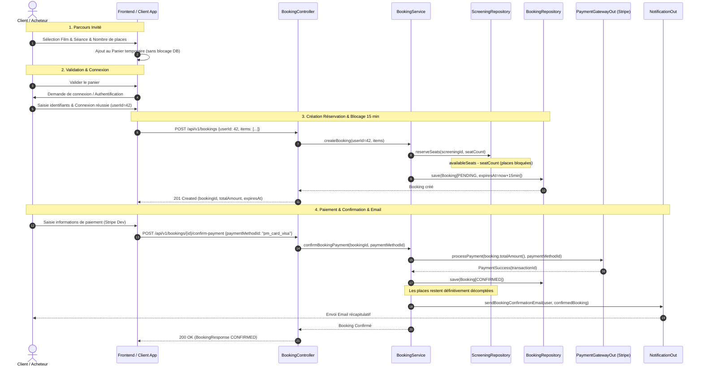

# Requirements

### Overview & Goals
L'objectif est d'adapter le processus d'achat de billets de cinéma pour offrir un parcours e-commerce moderne en plusieurs étapes :
1. Un visiteur non connecté constitue son **panier temporaire** (sélection du film, de la séance et du nombre de places) sans devoir créer de compte au préalable.
2. Lors de la validation du panier, s'il n'est pas connecté, le système l'invite à se connecter / s'identifier.
3. Dès que l'utilisateur est connecté, la réservation est enregistrée avec son `userId` et les places sélectionnées sont **bloquées pendant 15 minutes** (statut `PENDING`).
4. L'utilisateur procède au paiement via **Stripe (environnement de développement / simulation de paiement)**.
5. Si le paiement réussit :
   - Le blocage temporaire est converti en achat définitif (le nombre de places achetées est définitivement soustrait des places disponibles).
   - La réservation passe au statut `CONFIRMED`.
   - Un **e-mail de confirmation** récapitulatif est envoyé à l'utilisateur.
6. Si le paiement échoue, est annulé ou si les 15 minutes expirent, les places sont débloquées et réinjectées dans les disponibilités de la séance.

### Réponses aux Questions de l'Utilisateur
1. **Est-ce obligatoire l'id user actuellement ?**
   - **Oui dans le modèle de réservation (`Booking`)** : Le modèle `Booking.java` valide `userId != null`, car une réservation en base de données représente l'engagement d'un utilisateur identifié avec blocage de places pendant 15 minutes.
2. **Est-il possible d'avoir un panier temporaire sans avoir d'utilisateur ?**
   - **Oui, absolument** : Le panier temporaire invité est géré en amont (côté client / session / DTO). Aucun blocage de siège prématuré n'est effectué en base tant que le visiteur n'a pas validé son panier et ne s'est pas connecté. Dès la connexion, le contenu du panier est soumis pour créer la réservation officielle (`POST /api/v1/bookings`) qui déclenche le blocage de 15 minutes sous l'identifiant de l'utilisateur.

### Scope
- **In Scope :**
  - Parcours d'achat en 6 étapes :
    1. Sélection d'un film (`GET /api/v1/movies`)
    2. Sélection d'une séance (`GET /api/v1/movies/{id}/screenings`)
    3. Constitution du panier (sélection du nombre de places)
    4. Connexion / identification de l'utilisateur (authentification simple existante)
    5. Validation du panier -> Création de la réservation avec blocage des places pendant 15 minutes (`POST /api/v1/bookings`)
    6. Paiement Stripe (simulation dev) -> Confirmation de la réservation (`POST /api/v1/bookings/{id}/confirm-payment`) & envoi de l'e-mail de confirmation
  - Intégration d'un port de paiement `PaymentGatewayOut` avec implémentation de simulation Stripe (environnement dev / test).
  - Intégration d'un port de notification `NotificationOut` pour l'envoi de l'e-mail de confirmation.
  - Gestion du cycle de vie des places (blocage 15 min -> conversion en achat confirmé ou libération en cas d'annulation/expiration).
- **Out of Scope :**
  - Implémentation d'un serveur OAuth2/JWT complexe (Spring Security s'appuie sur l'identification existante, OAuth2/JWT reporté en Version 2).
  - Intégration d'une passerelle bancaire réelle en production (utilisation de l'environnement de développement / simulation Stripe).

### User Stories
- **En tant que visiteur non connecté**, je veux sélectionner un film, une séance et un nombre de places sans avoir à créer de compte immédiatement.
- **En tant qu'utilisateur**, je veux me connecter après avoir constitué mon panier afin que ma réservation soit liée à mon compte et ainsi bloquer pendant 15 minutes le nombre de places pour la ou les séances sélectionnées.
- **En tant qu'acheteur**, je veux payer ma réservation et recevoir un e-mail de confirmation contenant les détails de mes places.

### Functional Requirements
- **FR-1 : Panier temporaire invité** : Un visiteur peut composer son panier (sélection de film, séance et nombre de places) sans authentification préalable.
- **FR-2 : Étape de connexion préalable au blocage** : La validation du panier nécessite l'authentification de l'utilisateur.
- **FR-3 : Réservation & blocage temporaire (15 min)** : Dès la validation avec l'utilisateur connecté, `createBooking(userId, items)` crée une réservation `PENDING` et bloque les sièges (`ScreeningRepositoryOut.reserveSeats`) avec `expiresAt = now + 15 min`.
- **FR-4 : Paiement Stripe (Simulation Dev)** : L'utilisateur effectue le paiement via un port `PaymentGatewayOut` simulant l'API Stripe en mode test/développement.
- **FR-5 : Confirmation & Décompte définitif des places** : Lorsque le paiement est validé, la réservation passe à `CONFIRMED`. Le blocage temporaire est levé/validé et les places restent définitivement décomptées du stock de la séance.
- **FR-6 : Envoi d'e-mail de confirmation** : Dès la confirmation de paiement, un e-mail récapitulatif contenant les détails du film, de la séance, des places et du montant total est envoyé via `NotificationOut`.
- **FR-7 : Déblocage des places en cas d'annulation ou d'expiration** : Si le paiement n'aboutit pas ou si le délai de 15 minutes expire, les places bloquées sont automatiquement réinjectées dans les disponibilités de la séance (`ScreeningRepositoryOut.releaseSeats`).

### Non-Functional Requirements
- Respect strict des principes de l'architecture hexagonale (Clean Architecture).
- Séparation nette entre le domaine métier, les ports d'infrastructure (Stripe, Email, Persistance) et les adaptateurs web.
- Idempotence et robustesse des transactions lors du paiement et de la confirmation.

# Technical Design

### Current Implementation
- `Booking.java` : Record représentant une réservation avec validation stricte de `userId != null`.
- `BookingService.java` : Implémente la réservation avec déduction de places (`reserveSeats`), annulation (`releaseSeats`) et libération des réservations expirées (`releaseExpiredBookings`).
- `ScreeningRepositoryOut.java` & `PostgresScreeningAdapter.java` : Gèrent la déduction atomique (`availableSeats = availableSeats - :seatCount`) et la restitution (`availableSeats = availableSeats + :seatCount`).
- `BookingController.java` : Expose la création de réservation et la confirmation de paiement.

### Key Decisions
1. **Panier invité géré en amont sans blocage de sièges prématuré** :
   - *Décision* : Le panier temporaire non connecté est manipulé côté client / frontend. Le blocage des sièges (15 min) et la réservation en base de données s'activent au moment où l'utilisateur se connecte et soumet son panier (`POST /api/v1/bookings`).
   - *Rationale* : Évite d'encombrer la base de données et de bloquer inutilement les places du cinéma pour de simples visiteurs anonymes qui n'ont pas encore manifesté l'intention d'acheter en se connectant.
2. **Cycle de vie du blocage des places (Hold vs Commit vs Release)** :
   - *Création (`PENDING`)* : `ScreeningRepositoryOut.reserveSeats` soustrait immédiatement les places disponibles pour les retenir pendant 15 minutes.
   - *Paiement réussi (`CONFIRMED`)* : La réservation est confirmée, la retenue temporaire devient un achat définitif.
   - *Expiration / Annulation (`CANCELLED`)* : `ScreeningRepositoryOut.releaseSeats` réincrémente les places disponibles de la séance.
3. **Port de paiement Stripe Dev (`PaymentGatewayOut`)** :
   - *Décision* : Définir une interface `PaymentGatewayOut` dans le domaine et l'implémenter via `StripePaymentAdapter` (environnement dev / test / simulation de paiement Stripe).
   - *Rationale* : Permet d'isoler le SDK Stripe du domaine métier et facilite les tests automatisés sans dépendance externe obligatoire.
4. **Port de notification par e-mail (`NotificationOut`)** :
   - *Décision* : Définir `NotificationOut` dans le domaine pour déclencher l'envoi de l'e-mail de confirmation dès que le paiement est validé.
   - *Rationale* : Respecte l'inversion de dépendance et permet de brancher un adaptateur e-mail (ex: JavaMailSender / Mock) sans polluer la logique métier.

### Proposed Architecture & Workflow

```
┌────────────────────────────────────────────────────────────────────────────────────────┐
│                                     DOMAIN LAYER                                       │
│                                                                                        │
│  ┌─────────────────────────┐             ┌──────────────────────────────────────────┐  │
│  │      Booking Model      │             │              BookingService              │  │
│  │ (status, userId, items, │◄────────────┤  - createBooking(userId, items)          │  │
│  │  expiresAt, totalAmount)│             │  - processAndConfirmPayment(bId, token)  │  │
│  └─────────────────────────┘             │  - cancelBooking(bId)                    │  │
│                                          │  - releaseExpiredBookings()              │  │
│                                          └────────────────────┬─────────────────────┘  │
│                                                               │                        │
│                  ┌──────────────────────────────┬─────────────┴────────────┐           │
│                  ▼                              ▼                          ▼           │
│       ┌──────────────────────┐      ┌───────────────────────┐   ┌────────────────────┐ │
│       │ BookingRepositoryOut │      │   PaymentGatewayOut   │   │  NotificationOut   │ │
│       │ (Persistence Port)   │      │ (Stripe Dev Gateway)  │   │   (Email Port)     │ │
│       └──────────────────────┘      └───────────────────────┘   └────────────────────┘ │
└──────────────────┬──────────────────────────────┬──────────────────────────┬───────────┘
                   │                              │                          │            
                   ▼                              ▼                          ▼            
        ┌──────────────────────┐      ┌───────────────────────┐   ┌────────────────────┐  
        │ PostgresBookingAdapt │      │ StripePaymentAdapter  │   │ EmailNotifAdapter  │  
        │ (PostgreSQL / JPA)   │      │ (Stripe Dev / Mock)   │   │ (JavaMail / Log)   │  
        └───────────────────��──┘      └───────────────────────┘   └────────────────────┘  
```

#### Sequence Diagram



### Data Models / Contracts

#### 1. Ports du Domaine
- **`PaymentGatewayOut.java`** :
  ```java
  package com.cinema.cinema.domain.port.out;
  import java.math.BigDecimal;

  public interface PaymentGatewayOut {
      boolean processPayment(Long bookingId, BigDecimal amount, String paymentToken);
  }
  ```

- **`NotificationOut.java`** :
  ```java
  package com.cinema.cinema.domain.port.out;
  import com.cinema.cinema.domain.model.Booking;
  import com.cinema.cinema.domain.model.User;

  public interface NotificationOut {
      void sendBookingConfirmationEmail(User user, Booking booking);
  }
  ```

- **`ConfirmBookingPaymentUseCase.java`** :
  ```java
  package com.cinema.cinema.domain.port.in;
  import com.cinema.cinema.domain.model.Booking;

  public interface ConfirmBookingPaymentUseCase {
      Booking confirmBookingPayment(Long bookingId, String paymentToken);
  }
  ```

#### 2. DTOs Web & Requêtes
- **`ConfirmPaymentRequest.java`** :
  ```java
  public record ConfirmPaymentRequest(
      String paymentToken // ex: "tok_visa" ou stripe payment method ID (optionnel en mode simulation dev)
  ) {}
  ```

### Components & Files Affected
- `src/main/java/com/cinema/cinema/domain/port/out/PaymentGatewayOut.java` *(Nouveau)*
- `src/main/java/com/cinema/cinema/domain/port/out/NotificationOut.java` *(Nouveau)*
- `src/main/java/com/cinema/cinema/domain/port/in/ConfirmBookingPaymentUseCase.java` *(Modifié - accepte optionnellement le token de paiement)*
- `src/main/java/com/cinema/cinema/domain/service/BookingService.java` *(Modifié - orchestre le paiement Stripe dev et l'envoi d'e-mail)*
- `src/main/java/com/cinema/cinema/infrastructure/adapter/out/payment/StripePaymentAdapter.java` *(Nouveau - adaptateur Stripe dev / simulation)*
- `src/main/java/com/cinema/cinema/infrastructure/adapter/out/notification/EmailNotificationAdapter.java` *(Nouveau - adaptateur d'envoi d'e-mails)*
- `src/main/java/com/cinema/cinema/infrastructure/adapter/in/web/BookingController.java` *(Modifié - endpoint confirmPayment adapté)*
- `src/main/java/com/cinema/cinema/infrastructure/adapter/in/web/dto/ConfirmPaymentRequest.java` *(Nouveau)*
- `src/main/java/com/cinema/cinema/infrastructure/config/ApplicationConfig.java` *(Modifié - enregistrement des beans d'infrastructure)*

# Testing

### Validation Approach
La validation couvrira les scénarios nominaux et d'erreurs du parcours d'achat complet au moyen de tests unitaires sur le domaine (`BookingServiceTest`) et de tests d'intégration sur les contrôleurs REST (`BookingControllerTest`).

### Key Scenarios
1. **Création du panier et réservation après connexion** :
   - Appel à `POST /api/v1/bookings` avec `userId` et `items`.
   - Vérification de la réservation en statut `PENDING`.
   - Vérification du décompte temporaire de 15 min des places (`Screening.availableSeats`).
2. **Paiement Stripe réussi & Confirmation avec E-mail** :
   - Appel à `POST /api/v1/bookings/{id}/confirm-payment`.
   - Vérification du passage au statut `CONFIRMED`.
   - Vérification que `PaymentGatewayOut.processPayment` est appelé.
   - Vérification que `NotificationOut.sendBookingConfirmationEmail` est déclenché avec les détails du film, de la séance et des places.
3. **Annulation manuelle ou expiration (15 min)** :
   - Vérification que les places bloquées sont libérées et réinjectées dans les disponibilités (`ScreeningRepositoryOut.releaseSeats`).

### Edge Cases
1. **Tentative de paiement d'une réservation expirée** :
   - Vérifier le rejet (`IllegalStateException`) et la libération des sièges sans déclencher de débit Stripe ni d'e-mail.
2. **Échec du paiement Stripe (simulation carte refusée)** :
   - Vérifier que la réservation reste au statut `PENDING` (ou passe à `CANCELLED`) et que les places sont débloquées sans envoi d'e-mail.
3. **Nombre de places insuffisant lors de la validation du panier** :
   - Vérifier le rejet immédiat avec message clair et rollback des éventuelles réservations partielles.

### Test Changes
- `src/test/java/com/cinema/cinema/domain/BookingServiceTest.java` :
  - `should_confirm_booking_and_send_email_when_stripe_payment_succeeds()`
  - `should_not_confirm_booking_when_payment_fails()`
  - `should_release_seats_when_booking_expires()`
- `src/test/java/com/cinema/cinema/infrastructure/adapter/in/web/BookingControllerTest.java` :
  - `should_create_booking_and_confirm_with_payment()`

# Delivery Steps

### ✓ Step 1: Define Payment and Notification Domain Ports and Adapters
The domain layer defines clear ports for Stripe payment simulation and email notifications, with corresponding infrastructure adapters.

- Create output port `PaymentGatewayOut` in `com.cinema.cinema.domain.port.out` with payment execution method.
- Create output port `NotificationOut` in `com.cinema.cinema.domain.port.out` with `sendBookingConfirmationEmail(User user, Booking booking)`.
- Implement `StripePaymentAdapter` in `infrastructure.adapter.out.payment` configured for Stripe development / simulated test environment.
- Implement `EmailNotificationAdapter` in `infrastructure.adapter.out.notification` to handle booking confirmation emails.

### ✓ Step 2: Update BookingService for Stripe Payment and Email Confirmation
BookingService orchestrates seat reservation holds, Stripe payment verification, permanent seat deduction, and confirmation email dispatching.

- Inject `PaymentGatewayOut`, `NotificationOut`, and `UserRepositoryOut` into `BookingService`.
- Update `confirmBookingPayment` to process payment through `PaymentGatewayOut`, transition status to `CONFIRMED`, keep seats permanently deducted, and trigger `NotificationOut.sendBookingConfirmationEmail`.
- Ensure `cancelBooking` and `releaseExpiredBookings` continue to release blocked seats back to the screening availability.

### ✓ Step 3: Update REST Controller, DTOs, and Spring Configuration
The web layer exposes payment confirmation payloads and registers domain services and adapters in Spring application context.

- Create `ConfirmPaymentRequest` DTO in `infrastructure.adapter.in.web.dto`.
- Update `BookingController.confirmPayment` to accept optional payment token / method information in request body.
- Update `ApplicationConfig` to instantiate and inject `PaymentGatewayOut` and `NotificationOut` beans into `BookingService`.

### * Step 4: Implement Unit and Integration Tests for the Complete Purchase Flow
Automated tests validate the entire checkout, seat hold, Stripe payment confirmation, and notification pipeline.

- Add unit tests in `BookingServiceTest` covering successful Stripe payment confirmation, email dispatch, payment failure, and seat hold expiration.
- Add controller integration tests in `BookingControllerTest` validating the complete booking creation, payment confirmation, and error handling.
- Verify that seat counts are properly decremented upon booking and released upon expiration.