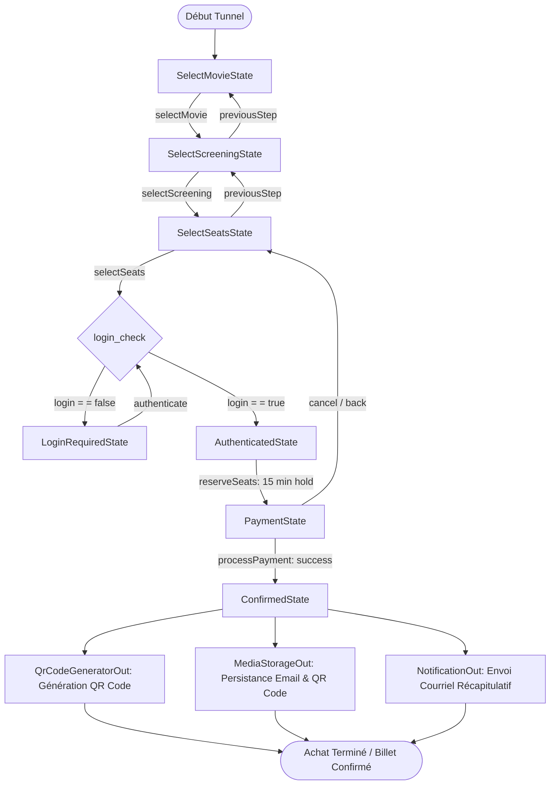

# Requirements

### Overview & Goals

L'objectif est d'implémenter le **State Pattern** (Patron d'état) pour orchestrer le tunnel d'achat de billets de cinéma
conformément au schéma d'états :

1. **Sélection du film** (`select_movie`)
2. **Sélection de la séance** (`selection_seance`)
3. **Sélection du nombre de places** (`selection_du_nombre_de_place`)
4. **Vérification d'authentification** (`login_check`) :
    - Si l'utilisateur est déjà connecté (`login == true`) -> Passage direct à `utilisateur_authentifie`.
    - Si l'utilisateur n'est pas connecté (`login == false`) -> Redirection vers `page_login`, puis retour vers
      `login_check` après connexion réussie.
5. **Utilisateur authentifié & blocage temporaire (15 min)** (`utilisateur_authentifie`) :
    - Association du panier à l'utilisateur (`userId`).
    - Création de la réservation au statut `PENDING` et blocage des places pendant 15 minutes.
6. **Paiement** (`paiement`) :
    - Exécution de la transaction via la passerelle de paiement (Stripe simulation).
7. **Post-paiement synchrone** :
    - **Génération du QR Code** (`generation_qrcode`) pour le billet.
    - **Persistance** du courriel et du QR Code sur le stockage média (`MediaStorageOut`).
    - **Envoi de l'e-mail de confirmation** (`envoie_email`) intégrant le QR Code.

### Scope

- **In Scope :**
    - Hiérarchie d'états State Pattern (`BookingFlowState`, `SelectMovieState`, `SelectScreeningState`,
      `SelectSeatsState`, `LoginRequiredState`, `AuthenticatedState`, `PaymentState`, `ConfirmedState`).
    - Contexte d'état `BookingFlowContext` encapsulant le cycle de vie du panier invité, la navigation avant/arrière
      (`previousStep`), l'annulation manuelle et le passage de relais à la réservation `PENDING`.
    - Intégration du port de génération de QR Code `QrCodeGeneratorOut` et de son adaptateur d'infrastructure.
    - Persistance du courriel et du QR Code généré via `MediaStorageOut` et envoi via `NotificationOut`.
    - Respect du cycle de libération des places au bout de 15 minutes en cas d'abandon de panier via
      `BookingCleanupScheduler`.
- **Out of Scope :**
    - Refonte complète de la sécurité Spring Security / JWT (l'authentification s'appuie sur la gestion existante des
      utilisateurs).
    - Intégration d'un serveur SMTP externe réel en production (simulation / logs dans l'adaptateur e-mail de
      développement).

### User Stories

- **En tant que visiteur**, je veux commencer mon parcours d'achat (choix du film, de la séance, des places) en mode
  invité et pouvoir revenir aux étapes précédentes si je change d'avis.
- **En tant que visiteur non connecté**, lorsque je valide mes places, je suis invité à me connecter pour finaliser ma
  commande sans perdre les sélections de mon panier.
- **En tant qu'utilisateur connecté**, dès ma connexion, mes places sont réservées pendant 15 minutes et je peux
  procéder au paiement sécurisé.
- **En tant qu'acheteur**, dès la confirmation de mon paiement, un QR code unique pour mes billets est généré et stocké,
  et je reçois un courriel de confirmation contenant ce QR Code.

### Functional Requirements

- **FR-1 : Navigation par états successifs** : Le tunnel d'achat force l'ordre des étapes (`Movie` -> `Screening` ->
  `Seats` -> `Auth/Hold` -> `Payment` -> `Confirmed`).
- **FR-2 : Navigation arrière et modification** : À tout moment avant le paiement, l'acheteur peut revenir à une étape
  précédente (`previousStep()`) ou annuler sa sélection.
- **FR-3 : Aiguillage conditionnel d'authentification (`login_check`)** :
    - Si `userId` est présent -> transition immédiate vers `AuthenticatedState` et déclenchement du blocage des places
      (15 min).
    - Si `userId` est absent -> transition vers `LoginRequiredState` en conservant les données du panier.
- **FR-4 : Blocage et libération des places** : Le passage à l'état `AuthenticatedState` soustrait les places de la
  séance (`ScreeningRepositoryOut.reserveSeats`). Si l'utilisateur annule ou abandonne son panier,
  `BookingCleanupScheduler` libère les places après expiration des 15 minutes (`ScreeningRepositoryOut.releaseSeats`).
- **FR-5 : Traitement du paiement** : En état `PaymentState`, la transaction est soumise à `PaymentGatewayOut`. En cas
  d'échec, le panier reste en attente de paiement ou peut être annulé.
- **FR-6 : Génération du QR Code et Persistance** : Dès la validation du paiement, `QrCodeGeneratorOut` génère le QR
  Code du billet, et le courriel ainsi que le QR Code sont sauvegardés via `MediaStorageOut`.
- **FR-7 : Notification par courriel** : L'e-mail de confirmation contenant le récapitulatif et le QR code est transmis
  via `NotificationOut`.

# Technical Design

### Current Implementation

- `Booking.java` : Record représentant une réservation (`userId != null`, statut `PENDING`, `CONFIRMED`, `CANCELLED`,
  expiration à 15 minutes).
- `BookingService.java` : Gère la création de réservation, la déduction atomique des places, l'annulation et la
  confirmation de paiement.
- `BookingCleanupScheduler.java` : Tâche planifiée (`@Scheduled(cron = "0 */5 * * * *")`) qui appelle
  `releaseExpiredBookingsUseCase.releaseExpiredBookings()` pour libérer les places après 15 minutes.
- `MediaStorageOut.java` & `RustFsStorageAdapter.java` : Port et adaptateur pour le stockage de fichiers / médias avec
  génération d'URL d'accès.
- `PaymentGatewayOut.java` & `StripePaymentAdapter.java` : Port et adaptateur de simulation de paiement.
- `NotificationOut.java` & `EmailNotificationAdapter.java` : Port et adaptateur d'envoi de notification de confirmation.

### Key Decisions

1. **Contexte de flux dédié (`BookingFlowContext`) vs Agrégat persistant** :
    - *Choix retenu* : Utiliser `BookingFlowContext` et l'interface `BookingFlowState`.
    - *Rationale* : Dans les étapes initiales (sélection du film, séance, places), l'utilisateur est potentiellement un
      visiteur anonyme non authentifié. L'entité de base de données `Booking` requiert impérativement un `userId` non
      nul et déclenche un blocage de ressources (sièges). Le `BookingFlowContext` encapsule la navigation invité, permet
      les retours en arrière sans écriture superflue en base, et instancie la réservation persistée `Booking` (avec
      retenue de 15 minutes) au moment où l'utilisateur est authentifié.
2. **Gestion des retours en arrière et annulation** :
    - *Navigation arrière* : Chaque état implémente la méthode `previousStep(BookingFlowContext ctx)` pour rétrograder
      proprement vers l'état précédent.
    - *Annulation / Abandon* : Si l'utilisateur annule avant `AuthenticatedState`, le panier en mémoire est réinitialisé
      sans impact sur la base. S'il annule après `AuthenticatedState`, les sièges bloqués sont libérés immédiatement via
      `ScreeningRepositoryOut.releaseSeats`. S'il ferme la page, le `BookingCleanupScheduler` existant libère
      automatiquement les places à l'issue du délai de 15 minutes.
3. **Double traitement Post-Paiement (QR Code & Courriel avec MediaStorage)** :
    - *Choix retenu* : À la transition vers `ConfirmedState`, `QrCodeGeneratorOut` produit le QR Code du billet. Le QR
      Code et le contenu du courriel sont persistés sur `MediaStorageOut` et intégrés dans l'e-mail envoyé par
      `NotificationOut`.

### Architecture Diagram (State Pattern Flow)



### Data Models / Contracts

#### 1. Interface d'état `BookingFlowState`

```java
package com.cinema.cinema.domain.model.state;

import com.cinema.cinema.domain.model.BookingFlowContext;

public interface BookingFlowState {
    BookingFlowStateName getName();

    void selectMovie(BookingFlowContext context, Long movieId);

    void selectScreening(BookingFlowContext context, Long screeningId);

    void selectSeats(BookingFlowContext context, int seatCount);

    void authenticate(BookingFlowContext context, Long userId);

    void processPayment(BookingFlowContext context, String paymentToken);

    void previousStep(BookingFlowContext context);

    void cancel(BookingFlowContext context);
}
```

#### 2. Contexte du tunnel d'achat `BookingFlowContext`

```java
package com.cinema.cinema.domain.model;

import com.cinema.cinema.domain.model.state.*;

import java.math.BigDecimal;
import java.util.List;

public class BookingFlowContext {
    private final String flowSessionId;
    private BookingFlowState currentState;
    private Long selectedMovieId;
    private Long selectedScreeningId;
    private Integer selectedSeatCount;
    private BigDecimal unitPrice;
    private Long authenticatedUserId;
    private Long bookingId;
    private String qrCodeUrl;

    public BookingFlowContext(String flowSessionId) {
        this.flowSessionId = flowSessionId;
        this.currentState = new SelectMovieState();
    }

    public void setState(BookingFlowState state) {
        this.currentState = state;
    }

    // Getters / Setters métier & délégation aux méthodes de l'état courant
}
```

#### 3. Nouveau Port pour la génération de QR Code `QrCodeGeneratorOut`

```java
package com.cinema.cinema.domain.port.out;

public interface QrCodeGeneratorOut {
    byte[] generateQrCodeImage(String content, int width, int height);

    String generateQrCodeBase64(String content);
}
```

#### 4. Evolution du Port de Notification `NotificationOut`

```java
package com.cinema.cinema.domain.port.out;

import com.cinema.cinema.domain.model.Booking;
import com.cinema.cinema.domain.model.User;

public interface NotificationOut {
    void sendBookingConfirmationEmail(User user, Booking booking, String qrCodeUrl, byte[] qrCodeData);
}
```

### Components & File Structure

- `com.cinema.cinema.domain.model.state` :
    - `BookingFlowState.java` *(Interface d'état)*
    - `BookingFlowStateName.java` *(Enum des étapes : SELECT_MOVIE, SELECT_SCREENING, SELECT_SEATS, LOGIN_REQUIRED,
      AUTHENTICATED, PAYMENT, CONFIRMED)*
    - `SelectMovieState.java`
    - `SelectScreeningState.java`
    - `SelectSeatsState.java`
    - `LoginRequiredState.java`
    - `AuthenticatedState.java`
    - `PaymentState.java`
    - `ConfirmedState.java`
- `com.cinema.cinema.domain.model` :
    - `BookingFlowContext.java` *(Contexte du tunnel)*
- `com.cinema.cinema.domain.port.out` :
    - `QrCodeGeneratorOut.java` *(Port de génération QR Code)*
    - `NotificationOut.java` *(Mis à jour)*
- `com.cinema.cinema.infrastructure.adapter.out.qrcode` :
    - `ZxingQrCodeAdapter.java` ou `DefaultQrCodeAdapter.java` *(Adaptateur QR Code)*
- `com.cinema.cinema.infrastructure.adapter.out.notification` :
    - `EmailNotificationAdapter.java` *(Mis à jour pour stocker l'email/QR sur MediaStorageOut et notifier)*
- `com.cinema.cinema.infrastructure.adapter.in.web` :
    - `BookingFlowController.java` / `BookingController.java` *(Endpoints pour piloter le tunnel)*
- `com.cinema.cinema.infrastructure.config` :
    - `ApplicationConfig.java` *(Enregistrement des beans)*

### Risks & Mitigations

- **Risque : Perte du panier invité lors du rafraîchissement de page**
    - *Mitigation* : Le `flowSessionId` identifie le contexte du tunnel transmis dans les en-têtes ou corps de requête.
- **Risque : Sièges bloqués indéfiniment si abandon après connexion**
    - *Mitigation* : L'état `AuthenticatedState` instancie la réservation avec `expiresAt = now + 15 min`, ce qui permet
      au `BookingCleanupScheduler` existant de nettoyer les réservations expirées et de libérer automatiquement les
      places.
- **Risque : Défaillance lors de l'envoi d'e-mail ou de la persistance S3**
    - *Mitigation* : La confirmation du paiement en base reste prioritaire et transactionnelle, la persistance du
      courriel et l'envoi d'e-mail sont gérés avec gestion d'erreurs tolérante sans corrompre le statut d'achat.

# Testing

### Validation Approach

La validation couvrira l'ensemble du cycle de vie du State Pattern au moyen de tests unitaires sur les états et le
contexte (`BookingFlowContextTest`, `BookingFlowStateTest`), de tests de service (`BookingServiceTest`) et de tests
d'intégration web (`BookingFlowControllerTest`).

### Key Scenarios

1. **Parcours nominal complet (Guest -> Connecté -> Payé -> Confirmé)** :
    - Initialisation dans `SelectMovieState`.
    - Sélection d'un film -> transition vers `SelectScreeningState`.
    - Sélection d'une séance -> transition vers `SelectSeatsState`.
    - Sélection du nombre de places sans être connecté -> transition vers `LoginRequiredState`.
    - Authentification de l'utilisateur -> passage du `login_check` -> transition vers `AuthenticatedState` et blocage
      des places (15 min).
    - Passage en `PaymentState` -> soumission du paiement Stripe -> transition vers `ConfirmedState`.
    - Vérification de la génération du QR Code, du stockage sur `MediaStorageOut` et de l'envoi d'e-mail via
      `NotificationOut`.
2. **Parcours utilisateur déjà connecté** :
    - Sélection des places avec `userId` renseigné -> transition directe de `SelectSeatsState` vers `AuthenticatedState`
      sans passer par `LoginRequiredState`.
3. **Navigation arrière (`previousStep`)** :
    - Depuis `SelectScreeningState` vers `SelectMovieState`.
    - Depuis `SelectSeatsState` vers `SelectScreeningState`.
    - Depuis `PaymentState` vers `SelectSeatsState` avec libération des places bloquées.
4. **Annulation manuelle ou abandon** :
    - Annulation du tunnel via `cancel()` en état `AuthenticatedState` / `PaymentState` -> libération immédiate des
      sièges dans `ScreeningRepositoryOut`.
    - Abandon sans annulation explicite -> libération par `BookingCleanupScheduler` après 15 minutes.

### Edge Cases

1. **Tentative d'opération invalide pour un état donné** :
    - Vérifier que tenter de payer (`processPayment`) en état `SelectMovieState` lève une `IllegalStateException`.
2. **Échec de paiement en `PaymentState`** :
    - Vérifier que le statut ne passe pas à `ConfirmedState`, que le QR Code et le courriel ne sont pas générés, et que
      l'utilisateur peut réessayer ou annuler.
3. **Nombre de places indisponibles lors de l'accès à `AuthenticatedState`** :
    - Vérifier la levée d'une exception avec message approprié et le maintien dans un état cohérent sans réservation
      fantôme.

### Test Changes

- `src/test/java/com/cinema/cinema/domain/model/state/BookingFlowStateTest.java` *(Nouveau)*
- `src/test/java/com/cinema/cinema/domain/model/BookingFlowContextTest.java` *(Nouveau)*
- `com/cinema/cinema/domain/BookingServiceTest.java` *(Mis à jour)*
- `com/cinema/cinema/infrastructure/adapter/in/web/BookingControllerTest.java` *(Mis à jour)*
- `src/test/java/com/cinema/cinema/infrastructure/adapter/out/qrcode/QrCodeAdapterTest.java` *(Nouveau)*

# Delivery Steps

### Step 1: Define QR Code Generation Port, Media Storage Integration, and Notification Contracts

The domain defines dedicated ports for QR code generation and enhanced notification persistence, alongside
infrastructure adapters.

- Create `QrCodeGeneratorOut` interface in `com.cinema.cinema.domain.port.out` returning generated QR code data (e.g.
  `byte[]` or Base64).
- Implement `QrCodeAdapter` in `infrastructure.adapter.out.qrcode` (using standard image/matrix generation or dev
  simulation).
- Update `NotificationOut` and `EmailNotificationAdapter` to accept generated QR codes, persist email and QR code
  artifacts to `MediaStorageOut`, and log/send the email.
- Register `QrCodeGeneratorOut` bean and update `NotificationOut` dependencies in `ApplicationConfig.java`.

### Step 2: Implement State Pattern Classes and BookingFlowContext in Domain Layer

The domain layer implements a full State pattern encapsulating each step of the purchase tunnel with forwards and
backwards transitions.

- Create `BookingFlowState` interface in `com.cinema.cinema.domain.model.state` defining tunnel actions:
  `selectMovie(Long movieId)`, `selectScreening(Long screeningId)`, `selectSeats(int seatCount)`,
  `authenticate(Long userId)`, `processPayment(String token)`, `previousStep()`, and `cancel()`.
- Create `BookingFlowContext` aggregate/context managing the current step state, transient cart data (movieId,
  screeningId, seatCount, userId), and the persisted `Booking` entity once authenticated.
- Implement concrete states:
    - `SelectMovieState`: Initial state allowing movie selection and advancing to screening choice.
    - `SelectScreeningState`: Allows screening selection and handles backward navigation to movie selection.
    - `SelectSeatsState`: Validates seat quantity, checks login status, and transitions to either `LoginRequiredState`
      (if guest) or `AuthenticatedState` (if authenticated).
    - `LoginRequiredState`: Prompts authentication; upon login success, transitions through login check to
      `AuthenticatedState`.
    - `AuthenticatedState`: Triggers 15-minute seat reservation hold (`ScreeningRepositoryOut.reserveSeats`), creates
      `PENDING` booking, and advances to `PaymentState`.
    - `PaymentState`: Calls `PaymentGatewayOut.processPayment`; on failure stays or cancels hold; on success transitions
      to `ConfirmedState`.
    - `ConfirmedState`: Generates ticket QR code via `QrCodeGeneratorOut`, saves email and QR code to `MediaStorageOut`,
      sends confirmation email via `NotificationOut`, and marks booking as `CONFIRMED`.

### Step 3: Expose Purchase Tunnel Endpoints and Integrate with Service Layer and Scheduler

The purchase flow state machine is exposed through use cases, REST controllers, and integrated with the background seat
cleanup scheduler.

- Create input ports `ProcessBookingFlowUseCase` and `GetBookingFlowStatusUseCase` in
  `com.cinema.cinema.domain.port.in`.
- Update or extend `BookingService` to instantiate, restore, and advance `BookingFlowContext` instances.
- Update `BookingController` (or add `BookingFlowController`) to provide endpoints for state advancement
  (`/select-movie`, `/select-screening`, `/select-seats`, `/authenticate`, `/pay`, `/back`, `/cancel`).
- Verify backward navigation and hold cancellation release seats immediately, while uncompleted abandoned sessions are
  cleaned up after 15 minutes by `BookingCleanupScheduler`.
- Wire all new beans and dependencies into `ApplicationConfig.java`.

### Step 4: Implement Unit and Integration Tests for Purchase Flow State Pattern

Automated tests validate each state transition, backwards navigation, guest login workflow, payment, QR code generation,
and email persistence.

- Add unit tests in `BookingFlowStateTest` and `BookingFlowContextTest` testing nominal forward transitions, invalid
  transitions for each state, backward transitions, and hold cancellation.
- Add unit tests in `BookingServiceTest` covering end-to-end tunnel progression, QR code generation, storage persistence
  on `MediaStorageOut`, and notification dispatch.
- Add integration tests in `BookingControllerTest` / `BookingFlowControllerTest` verifying HTTP status codes, response
  payloads, and session state progression.
- Verify that abandoned bookings in `AuthenticatedState` / `PaymentState` expire after 15 minutes and seats are released
  by `BookingCleanupScheduler`.