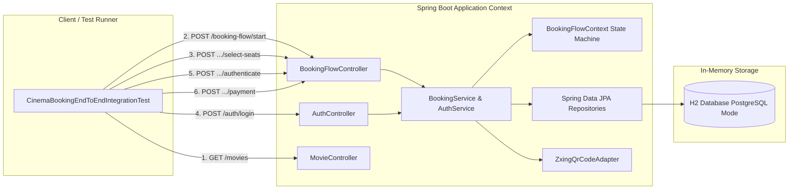

# Requirements

### Overview & Goals

L'objectif est d'implémenter une suite de **tests d'intégration globaux (End-to-End / E2E)** validant le parcours
complet d'achat de billets de cinéma à travers l'ensemble des couches réelles de l'application (Contrôleurs REST,
Machine à états du flux de réservation, Sécurité JWT, Services métier, Persistance Spring Data JPA / Flyway / H2 et
Adaptateurs externes).

### Scope

- **In Scope** :
    - Mise en place d'un profil de test dédié (`application-test.yaml`) avec base de données H2 configurée en
      compatibilité PostgreSQL et migrations Flyway automatiques.
    - Test E2E nominal du cycle de vente : Découverte du film $\rightarrow$ Sélection de séance $\rightarrow$ Sélection
      des places $\rightarrow$ Redirection Login & Authentification JWT $\rightarrow$ Retenue temporaire 15
      min $\rightarrow$ Paiement Stripe simulé $\rightarrow$ Confirmation finale, QR Code et Notification.
    - Tests d'intégration des cas d'erreur et cas limites : Token JWT invalide/expiré, dépassement de capacité de
      places, annulation et libération de stock, retour arrière dans le tunnel de réservation, invulnérabilité à la
      manipulation des prix client.
- **Out of Scope** :
    - Tests d'interface graphique (Selenium / Cypress).
    - Appels réseau externes vers une passerelle Stripe réelle de production ou un bucket S3 distant (utilisation
      d'adaptateurs locaux / mocks d'infrastructure).

### User Stories / Parcours Testés

- **En tant qu'acheteur cinéphile**, je souhaite parcourir les séances d'un film, bloquer mes places, m'authentifier par
  token JWT et payer ma commande pour recevoir mon QR code et retrouver ma réservation confirmée dans mon espace
  utilisateur.
- **En tant qu'acheteur interrompu**, je souhaite pouvoir revenir en arrière dans le tunnel ou annuler ma réservation
  pour que les places retenues soient immédiatement remises en vente.
- **En tant qu'administrateur système**, je souhaite m'assurer que le backend garantit la cohérence des stocks de places
  et applique strictement les tarifs officiels calculés côté serveur.

### Functional & Integration Requirements

- **FR-1 (Parcours Nominal E2E)** : Exécuter la chaîne HTTP complète sans mock des services applicatifs et vérifier la
  transition fluide d'état de `SELECT_MOVIE` jusqu'à `CONFIRMED`.
- **FR-2 (Intégration Persistance & Stock)** : Vérifier que les tables relationnelles (`movies`, `screenings`, `users`,
  `bookings`, `booking_items`) reflètent fidèlement l'état et que le stock `available_seats` est décrémenté/restauré
  avec exactitude.
- **FR-3 (Sécurité & Authentification JWT)** : Vérifier la transmission, validation et parsing du JWT à travers les
  requêtes REST.
- **FR-4 (Robustesse & Erreurs)** : Tester la gestion des erreurs HTTP (400, 401, 404, 409) lors des étapes non
  conformes.

# Technical Design

### Current Implementation & Gap Analysis

- Les tests existants sont principalement des tests unitaires (`BookingFlowStateTest`, `BookingServiceTest`,
  `AuthServiceTest`) ou des tests de contrôleurs isolés avec use cases mockés (`@WebMvcTest` avec `@MockitoBean`).
- Il n'existait pas de test validant l'intégration réelle entre la persistance (JPA + Flyway), la machine d'état du
  tunnel de vente (`BookingFlowContext`), la sécurité JWT (`JwtTokenProvider` / `AuthService`) et les adaptateurs
  d'infrastructure.

### Integration Test Architecture

- **Framework** : `@SpringBootTest(webEnvironment = SpringBootTest.WebEnvironment.MOCK)` avec `@AutoConfigureMockMvc`
  pour exécuter la totalité du contexte Spring et de la pile HTTP sans instancier de serveur de socket externe.
- **Base de données de test** : H2 in-memory avec syntaxe PostgreSQL
  (`jdbc:h2:mem:cinema_test;MODE=PostgreSQL;DATABASE_TO_LOWER=TRUE;DEFAULT_NULL_ORDER=HIGH`), garantissant l'exécution
  stricte des migrations Flyway `V1`, `V2` et `V3`.
- **Composants d'infrastructure réels** :
    - `PostgresBookingAdapter`, `PostgresScreeningAdapter`, `PostgresMovieAdapter`, `PostgresUserAdapter` exécutés sur
      la base H2 réelle.
    - Machine à états (`BookingFlowContext`) et `BookingService` réels.
    - `JwtTokenProvider` et `AuthService` réels.
    - `ZxingQrCodeAdapter` réel.
    - `RustFsStorageAdapter` / `S3Presigner` configuré ou mocké pour la génération d'URL d'affiche sans dépendance
      réseau RustFS externe.

### Architecture & Journey Flow Diagram

### Test Files Structure

- `src/test/resources/application-test.yaml` *(Nouveau)* : configuration H2 et Flyway pour les tests d'intégration.
- `src/test/java/com/cinema/cinema/integration/AbstractIntegrationTest.java` *(Nouveau)* : classe socle de configuration
  MockMvc & Helpers JSON.
- `src/test/java/com/cinema/cinema/integration/CinemaBookingEndToEndIntegrationTest.java` *(Nouveau)* : scénario nominal
  complet d'achat.
- `src/test/java/com/cinema/cinema/integration/BookingFlowEdgeCasesIntegrationTest.java` *(Nouveau)* : scénarios
  d'erreurs, expirations, annulations et capacité.

# Testing

### Validation Approach

Les tests d'intégration s'exécutent via Maven (`./mvnw test` ou `mvn test`) et valident l'ensemble des interactions sans
dépendance externe requise (DB PostgreSQL ou RustFS en dur).

### Key Scenarios

#### 1. Parcours Nominal E2E (`CinemaBookingEndToEndIntegrationTest`)

1. `GET /api/v1/movies` & `GET /api/v1/movies/{id}` $\rightarrow$ Récupération du film avec `synopsis` et `trailerUrl`.
2. `GET /api/v1/screenings/movie/{id}` $\rightarrow$ Récupération de la séance et vérification du tarif serveur et des
   places initiales (ex: 50).
3. `POST /api/v1/booking-flow/start` $\rightarrow$ Réception du `flowSessionId` et état `SELECT_MOVIE`.
4. `POST /api/v1/booking-flow/{id}/select-movie` $\rightarrow$ État `SELECT_SCREENING`.
5. `POST /api/v1/booking-flow/{id}/select-screening` $\rightarrow$ État `SELECT_SEATS`.
6. `POST /api/v1/booking-flow/{id}/select-seats` (2 places) $\rightarrow$ État `LOGIN_REQUIRED`,
   `loginUrl: /api/v1/auth/login`.
7. `POST /api/v1/auth/register` (ou login) $\rightarrow$ Obtention du token JWT valide.
8. `POST /api/v1/booking-flow/{id}/authenticate` avec le JWT $\rightarrow$ État `AUTHENTICATED`, création du booking en
   base (`PENDING`), initialisation de `expiresAt` (now + 15 min), retenue de 2 places (reste 48 places).
9. `POST /api/v1/booking-flow/{id}/payment` $\rightarrow$ État `CONFIRMED`, génération de `qrCodeUrl`, passage du statut
   en base à `CONFIRMED`.
10. `GET /api/v1/users/{userId}/bookings` $\rightarrow$ La réservation apparaît avec le montant total officiel exact
    (2 $\times$ tarif unitaire).

#### 2. Parcours d'Erreurs et Cas Limites (`BookingFlowEdgeCasesIntegrationTest`)

1. **Échec d'authentification JWT** : `POST .../authenticate` avec token invalide ou corrompu $\rightarrow$ reste en
   `LOGIN_REQUIRED` avec `loginUrl`.
2. **Annulation et libération de places** : `POST .../cancel` à l'état `AUTHENTICATED` $\rightarrow$ passage du booking
   à `CANCELLED` et restauration des places sur la séance (retour à 50).
3. **Retour en arrière (`previous-step`)** : navigation arrière depuis `SELECT_SEATS` vers `SELECT_SCREENING` et
   validation du changement de sélection.
4. **Capacité insuffisante** : tentative de sélection de plus de places que le stock disponible $\rightarrow$ rejet
   contrôlé et maintien de l'intégrité de la séance.
5. **Tentative de falsification de prix** : vérification que le montant calculé et stocké en base ignore tout prix
   client arbitraire et s'appuie à 100% sur le tarif de la séance.

# Delivery Steps

### Step 1: Configurer l'environnement et l'infrastructure de test d'intégration

Mettre en place un profil Spring de test avec une base H2 en mode PostgreSQL et des jeux de données d'initialisation.

- Créer `src/test/resources/application-test.yaml` pour configurer la base de données H2 en mémoire
  (`jdbc:h2:mem:cinema_test;MODE=PostgreSQL;DATABASE_TO_LOWER=TRUE`) et l'exécution automatique des migrations Flyway.
- Configurer les mocks ou fakes d'infrastructure pour les services externes ne nécessitant pas d'appel réseau réel (ex:
  génération d'URL présignée S3 / RustFS).
- Créer une classe de base de test d'intégration (`AbstractIntegrationTest`) annotée avec `@SpringBootTest` et
  `@AutoConfigureMockMvc` pour factoriser le contexte Spring et les utilitaires JSON / assertions.

### Step 2: Implémenter le test d'intégration du parcours nominal complet (E2E)

Implémenter le scénario complet d'achat de places de cinéma depuis la consultation jusqu'à la confirmation de commande.

- Créer la classe de test `CinemaBookingEndToEndIntegrationTest`.
- Étape 1 : Récupérer le catalogue de films (`GET /api/v1/movies`) et sélectionner un film (`GET /api/v1/movies/{id}`).
- Étape 2 : Récupérer les séances disponibles pour ce film (`GET /api/v1/screenings/movie/{movieId}`).
- Étape 3 : Démarrer un flux de réservation (`POST /api/v1/booking-flow/start`) et initialiser l'état `SELECT_MOVIE`.
- Étape 4 : Sélectionner le film et la séance (`POST .../select-movie` puis `POST .../select-screening`).
- Étape 5 : Sélectionner le nombre de places (`POST .../select-seats`) -> transition vers l'état `LOGIN_REQUIRED` avec
  `loginUrl`.
- Étape 6 : Enregistrer / connecter un utilisateur via `POST /api/v1/auth/register` ou `/login` -> obtention du token
  JWT.
- Étape 7 : Authentifier la session de réservation via `POST .../authenticate` avec le token JWT -> transition vers
  `AUTHENTICATED`, retenue des places pendant 15 min (`expiresAt`) et création de la réservation `PENDING`.
- Étape 8 : Finaliser le paiement via `POST .../payment` -> transition vers `CONFIRMED`, génération du QR code et
  notification email.
- Étape 9 : Vérifier la persistance effective en base (`GET /api/v1/users/{id}/bookings`) et la mise à jour des places
  disponibles de la séance.

### Step 3: Implémenter les tests d'intégration des parcours d'erreur et cas limites

Valider la robustesse du système face aux cas d'erreurs, expirations, annulations et tentatives de manipulation de prix.

- Tester l'échec d'authentification avec un token JWT invalide ou expiré lors de l'étape `POST .../authenticate`
  (maintien à l'état `LOGIN_REQUIRED`).
- Tester la libération automatique des places lors de l'annulation d'un flux (`POST .../cancel`).
- Tester la navigation arrière (`POST .../previous-step`) pour modifier la sélection de places ou de séance.
- Tester le rejet d'une réservation lorsque le nombre de places demandées excède la capacité restante de la salle.
- Vérifier l'immunité contre la manipulation de prix : le montant débité et enregistré correspond systématiquement au
  tarif officiel serveur.